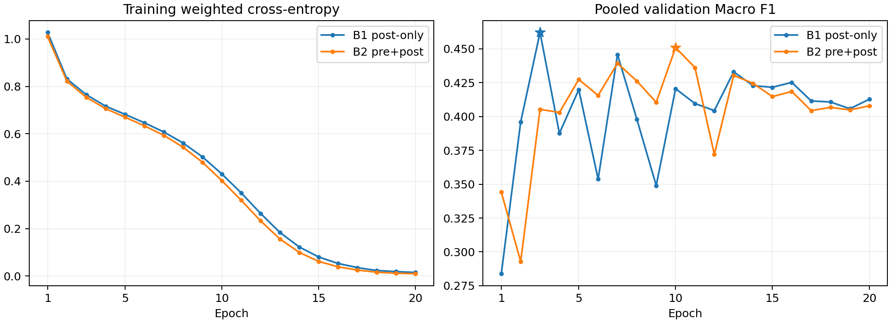
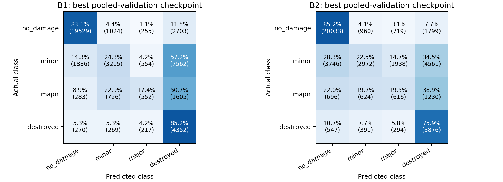

# B1 / B2 扩大实验对比报告

生成时间（北京时间）：2026-10-22T02:54:05.313418+08:00

两模型均已完成20/20轮。当前单seed的合并验证集 Macro F1 为B1较高，B2−B1 = -0.011150（-1.115个百分点）。
这是按同一合并验证集选取最佳权重后的验证结果，不是独立测试成绩，也不足以证明稳定或显著的优劣。

B2最后4轮于北京时间2026-10-22 02:53完成，本次续训含启动/校验共3.32小时；4轮子进程均正常退出，无需启用第九小时。训练和后续衔接进程均已退出。

## 实验与可比性

- B1：灾后3通道；B2：灾前＋灾后6通道。均为随机初始化ResNet-18，seed42，batch32，crop128，20轮。
- 相同5训练事件、104,152栋；相同2验证事件、45,002栋；完整配置、manifest、样本索引、冻结源码和软件版本均通过一致性守卫。
- 每个模型按合并验证集Macro F1选最佳轮次；下方分事件与各类别指标都来自该同一个权重，没有另选各事件最优轮次。
- 两份last和best权重均实际载入检查；所有20轮历史、配置、源码与清单一致。未重新训练、未新增推理、未使用封存测试集。

## 总体结果

| 指标 | B1 | B2 | B2−B1 |
| --- | ---: | ---: | ---: |
| macro_f1 | 0.462021 | 0.450870 | -0.011150 |
| accuracy | 0.614373 | 0.611017 | -0.003355 |
| balanced_accuracy | 0.525057 | 0.507577 | -0.017480 |
| 最佳轮次 | 3 | 10 | — |

## 分事件结果

| 验证事件 | 建筑数 | B1 Macro F1 | B2 Macro F1 | B2−B1 |
| --- | ---: | ---: | ---: | ---: |
| hurricane-matthew | 22630 | 0.267685 | 0.252964 | -0.014720 |
| moore-tornado | 22372 | 0.696658 | 0.699588 | +0.002930 |

## 各类别结果

| 类别 | 数量 | B1 P/R/F1 | B2 P/R/F1 | F1差值 |
| --- | ---: | --- | --- | ---: |
| no_damage | 23511 | 0.8890/0.8306/0.8588 | 0.8006/0.8521/0.8255 | -0.0333 |
| minor | 13217 | 0.6143/0.2432/0.3485 | 0.6008/0.2249/0.3272 | -0.0212 |
| major | 3166 | 0.3498/0.1744/0.2327 | 0.1727/0.1946/0.1830 | -0.0497 |
| destroyed | 5108 | 0.2683/0.8520/0.4081 | 0.3380/0.7588/0.4677 | +0.0597 |

## 观察与解释边界

- B1训练loss由1.0275降至0.0148；最佳验证在第3轮，第20轮验证Macro F1=0.4127，相对最佳轮次差-0.0493。训练loss下降未转化为持续验证提升，符合泛化受限/过拟合的表现；仅凭曲线不能确定具体成因。
- B1在moore-tornado的Macro F1为0.6967，在hurricane-matthew为0.2677；事件间差异应单独报告，当前指标不能把差异归因于某一种视觉或标注因素。
- B2训练loss由1.0104降至0.0097；最佳验证在第10轮，第20轮验证Macro F1=0.4078，相对最佳轮次差-0.0430。训练loss下降未转化为持续验证提升，符合泛化受限/过拟合的表现；仅凭曲线不能确定具体成因。
- B2在moore-tornado的Macro F1为0.6996，在hurricane-matthew为0.2530；事件间差异应单独报告，当前指标不能把差异归因于某一种视觉或标注因素。
- B2相对B1的类别F1：提升类为destroyed；下降类为no_damage、minor、major。具体precision/recall权衡见上表与混淆矩阵。
- 合并Macro F1由合并混淆矩阵计算，并非两个事件Macro F1的平均；不同事件类别构成不同，合并表和分事件表应一起解读。
- 原四事件实验只用moore-tornado验证；本次增加hurricane-matthew，因此新旧合并分数不能直接用于判断扩充训练数据是否造成退步。
- 只有一个随机种子；没有独立测试集成绩，也未做显著性检验。当前可以描述本次受控验证观察，不能推广为灾前图像普遍有效或无效。

## 资源与运行记录

| 项目 | B1 | B2 |
| --- | ---: | ---: |
| 模型参数 | 11,178,564 | 11,187,972 |
| 累计轮次训练＋验证时间（小时） | 15.07 | 16.91 |

两模型记录同一GPU型号，但在多个时段断点续训，系统负载可能不同；以上累计时间不含完整启动/校验开销，也不是隔离架构因素的速度比较。本次没有新增延迟或显存基准测试。

## 曲线与混淆矩阵

## 交付文件

- comparison.json / comparison.csv：完整总体、分事件与类别指标。
- checkpoint_verification.json：断点一致性核验与SHA256。
- 完整20轮历史及原始summary分别见 [B1](b1/) / [B2](b2/)。
- best/last权重与完整manifest见 [GitHub Release](https://github.com/Ethan-bot912/DDA4220/releases/tag/expanded-seed42-20261022) 的完整实验包；原始影像不随包发布。
- Git发布保留训练时的原始元数据；发布提交不冒充训练时的Git状态，核心源码以记录的SHA256绑定。
