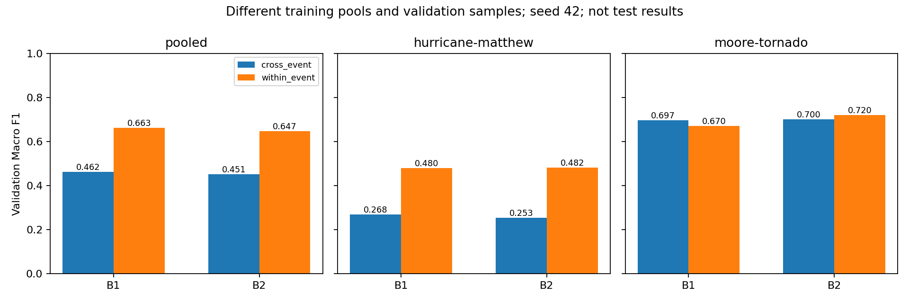
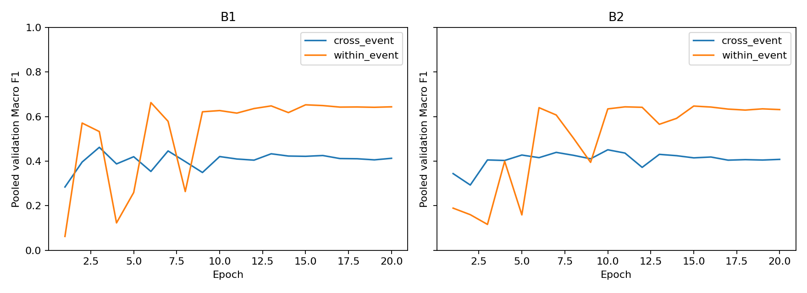

# 事件内与跨事件划分：seed42 验证结果分析

本报告整理已完成的训练记录，不新增训练、推理或测试评估。两种划分下 B1/B2 均完成20轮。事件内合并验证 Macro F1 提高约20个百分点，主要改善来自 Matthew；这是诊断性证据，不是跨事件泛化提升的证明。

## 1. 研究问题与实验过程

原实验用5个事件训练，在未见过的 Matthew、Moore 上验证。本次只取这两个事件，按 (event, tile_id) 整块分配到约60%训练、20%验证、20%内部测试；同一块的建筑不可跨集合。确定性贪心与移动/交换精修平衡建筑数和类别数，划分被冻结，没有按成绩重抽。

训练前完成环境修复、31项Python测试、10项串联检查、合成训练/续训验收、数据审计和数据锁核验（历史执行证据见本机 output/within_event_mm/freeze）。训练版本为 3ba5e61dd92f7400e1b169c1638a770e10820d03，B1先运行，B2随后运行并从断点完成；2026-10-24两者均完成20轮。报告发布版本不冒充训练版本。

ResNet-18随机初始化、无预训练/增强、crop128/context16、batch32、AdamW lr0.001/weight_decay0.01、20轮cosine、seed42、float32均保持一致。类别权重各自只用训练集计算；各模型按合并验证Macro F1严格提升选best，所有分事件指标来自同一个best。

| 设置 | 跨事件 expanded | 事件内 within-event |
| --- | --- | --- |
| 训练数据 | 5事件，104152栋 | Matthew＋Moore，26976栋 |
| 验证数据 | Matthew＋Moore全体45002栋 | 两事件9014栋，原验证池的子集 |
| 内部测试 | 无本次事件内测试划分 | 9012栋，未评估 |
| 防泄漏单位 | 事件分离，tile也分离 | tile分离，事件共享 |
| 问题 | 能否迁移到未见灾害事件 | 能否识别已见事件的其他影像块 |

当前只验证tile标识不重叠，不代表已经验证跨tile的地理距离、影像覆盖不重叠或空间独立性。项目级封存事件与这9012栋内部test是两套不同范围，均没有本次测试成绩。

## 2. 总体与分事件结果

| 范围 | 模型 | 旧验证n | 新验证n | 跨事件F1 | 事件内F1 | 差值/百分点 |
| --- | --- | --- | --- | --- | --- | --- |
| pooled | B1 | 45002 | 9014 | 0.462021 | 0.662639 | +20.06 |
| pooled | B2 | 45002 | 9014 | 0.450870 | 0.646984 | +19.61 |
| hurricane-matthew | B1 | 22630 | 4537 | 0.267685 | 0.479712 | +21.20 |
| hurricane-matthew | B2 | 22630 | 4537 | 0.252964 | 0.482191 | +22.92 |
| moore-tornado | B1 | 22372 | 4477 | 0.696658 | 0.669532 | -2.71 |
| moore-tornado | B2 | 22372 | 4477 | 0.699588 | 0.720215 | +2.06 |

| 模型 | 指标 | 跨事件 | 事件内 | 差值/百分点 |
| --- | --- | --- | --- | --- |
| B1 | accuracy | 0.614373 | 0.786887 | +17.25 |
| B1 | balanced_accuracy | 0.525057 | 0.665649 | +14.06 |
| B2 | accuracy | 0.611017 | 0.781007 | +17.00 |
| B2 | balanced_accuracy | 0.507577 | 0.641922 | +13.43 |

## 3. 哪些类别改善，哪些困难仍在

以下为合并验证集；分事件的每类precision/recall/F1及support完整保存在 per_class.csv。

| 模型 | 类别 | 旧n | 新n | 旧F1 | 新F1 | 差值/百分点 | 新P/R |
| --- | --- | --- | --- | --- | --- | --- | --- |
| B1 | no_damage | 23511 | 4701 | 0.8588 | 0.8892 | +3.04 | 0.9383/0.8449 |
| B1 | minor | 13217 | 2653 | 0.3485 | 0.7442 | +39.57 | 0.6740/0.8308 |
| B1 | major | 3166 | 635 | 0.2327 | 0.2792 | +4.65 | 0.3291/0.2425 |
| B1 | destroyed | 5108 | 1025 | 0.4081 | 0.7379 | +32.98 | 0.7315/0.7444 |
| B2 | no_damage | 23511 | 4701 | 0.8255 | 0.8945 | +6.89 | 0.9404/0.8528 |
| B2 | minor | 13217 | 2653 | 0.3272 | 0.7407 | +41.35 | 0.6645/0.8368 |
| B2 | major | 3166 | 635 | 0.1830 | 0.2431 | +6.01 | 0.2599/0.2283 |
| B2 | destroyed | 5108 | 1025 | 0.4677 | 0.7096 | +24.19 | 0.7817/0.6498 |

轻度损毁与完全摧毁的合并F1改善突出，但major仍较弱。B1在Matthew的no_damage召回率仅0.1515，major召回率0.2018；不能用总体提升掩盖残余错误。Moore的major验证样本仅90栋，minor仅178栋，类别分数容易波动。

## 4. 灾前融合是否更有用

跨事件合并 B2−B1 为−1.115个百分点；事件内为−1.565个百分点，整体仍未胜出。事件内Matthew上B2比B1高0.248个百分点、Moore高5.068个百分点。分事件都略高而合并更低并不矛盾：合并Macro F1基于合并混淆矩阵计算，不是事件分数的平均。不能据此宣称灾前信息普遍有效，也不能断言其完全无效。

## 5. 如何解释划分的影响

模型接触目标事件的训练样本后，Matthew分数明显恢复，支持事件分布差异是旧低分的重要因素之一。Matthew的minor占比54.5%、no_damage占比17.9%，与旧训练池明显不同，标签先验差异是可能机制；视觉环境、标注与空间相关性也可能参与，当前实验无法拆分其贡献。

协议原文中“只差划分一个变量”的说法应理解为诊断目的，不能作为严格因果描述：训练事件、训练样本量、类别权重、每轮更新步数和验证样本均同时改变。旧验证池还包含如今用作训练的样本。这里报告的是两套评估条件的描述性差异，不是同一独立测试集上的配对提升或划分方法的净因果效应。协议保留原文以便溯源，本报告明确更正解释边界。

仅有一个训练seed、一个确定性划分；未进行显著性检验或跨seed稳定性检验。验证集参与best选择，存在选优偏差。B1在Moore下降说明改善并不一致。内部test未评估，不能把当前验证数写成最终test结论。

最早四事件实验只用Moore验证，B1/B2为0.601236/0.602278；它与扩大实验的合并验证范围不同，不能串成一个不加说明的性能排行榜。

## 6. 后续工作（未执行）

冻结所有选择后，经用户授权对内部test进行一次最终评估。若要更严格估计划分/目标事件暴露的影响，应事先定义固定且未使用过的评估tile、匹配训练规模与更新预算、多个训练seed及空间隔离方案。已有验证结果可以用于形成假设，不能回头挑划分以放大提升。

## 7. 证据与复核

b1/seed42/attempt01/、b2/seed42/attempt01/保存未经改写的summary、history和run_metadata（保留当时本机路径和git_dirty记录）。split_map与split_report为原始冻结副本。comparison表由原始summary导出。运行 `python tools/prepare_within_event_publication.py` 可直接使用仓库精选记录重建报告，无需数据清单或影像；脚本会核对20轮、best选择、混淆矩阵重算F1、记录内来源一致性，不运行模型。仅下载本报告目录时，可直接用保存的混淆矩阵复核指标。

